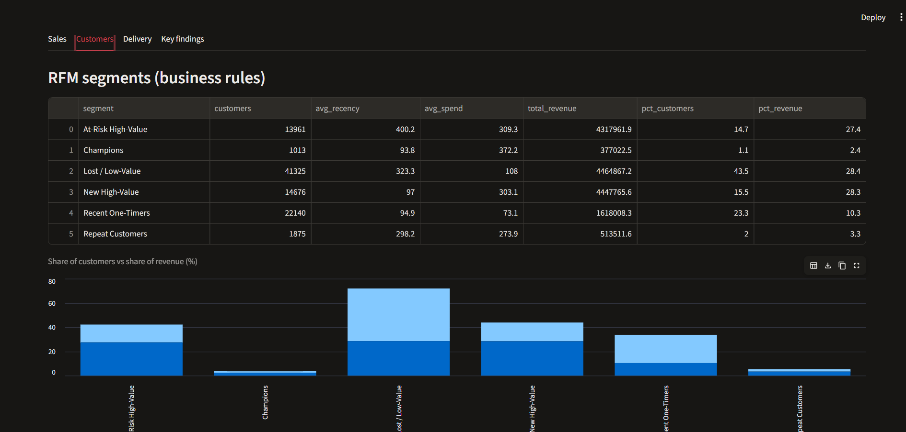
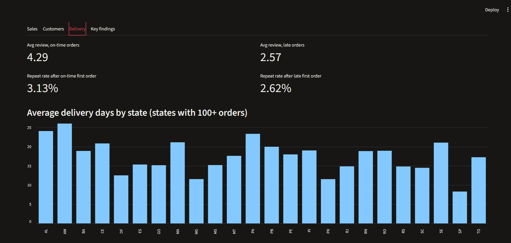

# E-commerce Sales & Customer Analytics

End-to-end analysis of about 100K orders from the Olist Brazilian e-commerce marketplace: sales trends, customer segmentation (RFM and K-Means) and delivery performance, with an interactive Streamlit dashboard.

**Live dashboard:** https://ecommerce-sales-customer-analytics-8cdgizc2notutf8aquoeh7.streamlit.app/

## Business questions
- Where does revenue come from, and how is it trending?
- Which customers matter most?
- Why do customers not come back?

## Key findings
- Revenue grew about 5.6x through 2017 (peak at Black Friday, Nov 2017), driven by order volume, not larger baskets.
- 97% of customers bought only once.
- One cluster (30% of customers) generated 58% of revenue: high-value one-time buyers.
- 8.1% of orders arrived late; late orders scored about 1.7 stars lower and had about 16% lower repeat purchase.
- Even 5-star customers repurchased only about 3% of the time, so retention needs active programs.

## Screenshots
.png)
.png)



## Approach
1. Loaded and cleaned 7 tables (orders, customers, items, payments, reviews, products, category translation).
2. Aggregated items, payments and reviews to one row per order before joining, to avoid duplicated revenue.
3. Analysed monthly sales, average order value and category revenue.
4. Built RFM scores and rule-based segments, then K-Means (k=4) on log-scaled, standardised features.
5. Analysed late deliveries, reviews and repeat purchases.
6. Built a Streamlit dashboard from the summary tables.

## Tech stack
Python, Pandas, NumPy, scikit-learn, Matplotlib, Seaborn, Streamlit, Git

## Run it locally
```
pip install -r requirements.txt
streamlit run app.py
```
To rerun the notebook, download the dataset from Kaggle (Brazilian E-Commerce Public Dataset by Olist) and place the CSV files in a `data/` folder.

## Limitations
Public dataset (2016 to 2018, Brazil). The 3% repeat rate partly reflects a short time window. Delivery findings show association, not proven cause.